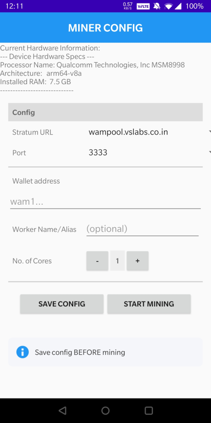
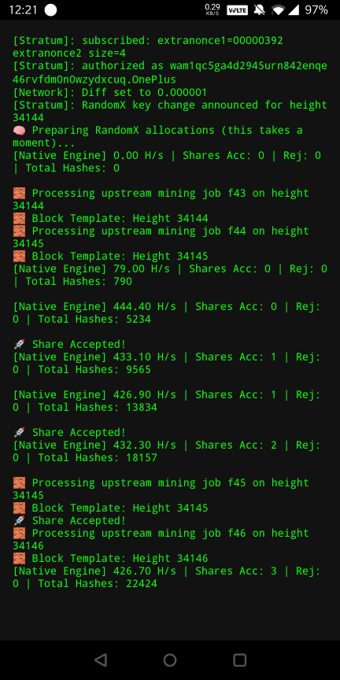

# Application User Manual

This manual provides a detailed breakdown of each screen, its available UI controls, the underlying
background activities, and the operational app flow.

---

### 1. Main Welcome Screen (`MainActivity`)

| Screen Image                                      | Description & Application Flow                                                                                                                                                                                                                                                                                                                                                                                                                                                                                                                                                                                                                                                                                                                                                                                            |
|:--------------------------------------------------|:--------------------------------------------------------------------------------------------------------------------------------------------------------------------------------------------------------------------------------------------------------------------------------------------------------------------------------------------------------------------------------------------------------------------------------------------------------------------------------------------------------------------------------------------------------------------------------------------------------------------------------------------------------------------------------------------------------------------------------------------------------------------------------------------------------------------------|
|  | **Screen Description** The initial landing screen that welcomes users to the application and provides access to project details.  **UI Controls & Actions** • **Get Started Button:** Takes User to the Miner Configuration screen. • **About Icon:** Opens an information dialog displaying application version details.  **Background Activity** • Detects Hardware information of device and displays it to the user on screen load. • Runs a GET call to https://wamnode.vslabs.co.in/api/getpools to get a list of available pools and their port(s). • The Get Started button enables ONLY if this succeeds. • Checks if an existing configuration exists.  **What Happens Next** • Clicking "Get Started" transitions the user directly to the **Configuration Screen**. |

---

### 2. Miner Configuration Screen (`ConfigActivity`)

| Screen Image                                      | Description & Application Flow                                                                                                                                                                                                                                                                                                                                                                                                                                                                                                                                                                                                                                                                                                                                                                                                                                    |
|:--------------------------------------------------|:------------------------------------------------------------------------------------------------------------------------------------------------------------------------------------------------------------------------------------------------------------------------------------------------------------------------------------------------------------------------------------------------------------------------------------------------------------------------------------------------------------------------------------------------------------------------------------------------------------------------------------------------------------------------------------------------------------------------------------------------------------------------------------------------------------------------------------------------------------------|
|  | **Screen Description** Miner Configuration setup screen  **UI Controls & Actions** • **Stratum URL & Port:** Selection drop-downs to target specific mining pool servers and their respective ports. • **Wallet Address & Worker Name Fields:** Input text fields for defining the payout address and the rig name. • **Cores :** Interactive controls to decrease or increase the number of allocated CPU cores. • **Save Config Button:** Saves the configuration and prepares miner service. • **Start Mining Button:** Immediately launches the miner threads and attaches them to the miner service.  **Background Activity** • No background activity until a button is pressed.  **What Happens Next** • Clicking "Start Mining" provisions the execution threads and redirects the user to the **Logs Screen**. |

---

### 3. Live Console Logs Screen (`LogsActivity`)

| Screen Image                                      | Description & Application Flow                                                                                                                                                                                                                                                                                                                                                                                                                                                                                                                                                                                             |
|:--------------------------------------------------|:---------------------------------------------------------------------------------------------------------------------------------------------------------------------------------------------------------------------------------------------------------------------------------------------------------------------------------------------------------------------------------------------------------------------------------------------------------------------------------------------------------------------------------------------------------------------------------------------------------------------------|
|  | **Screen Description** An output terminal tracking mining performance.  **UI Controls & Actions** • **Log Display Terminal:** A scrollable text box rendering continuous runtime output streams at 10s intervals.  **Background Activity** • Maintains an active listener thread tied directly to the native mining service.  **What Happens Next** • The user remains on this screen to monitor continuous live updates. Using the hardware or system back button terminates the mining service after confirmation, then navigates back to the **Configuration Screen** to make edits. |
