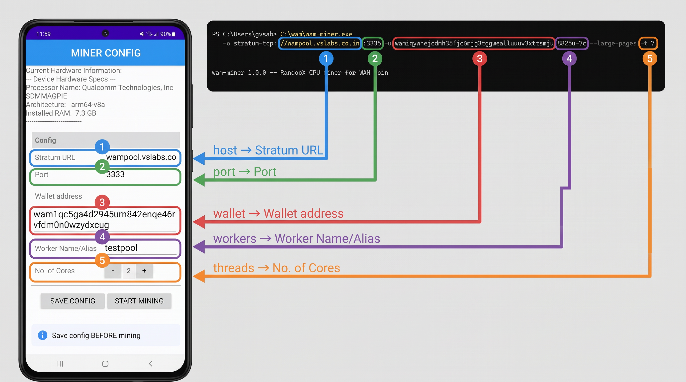

# WAM Coin Android Miner

**An Android-native mining application for WAM Coin**, a CPU-mineable proof-of-work currency
featuring RandomX execution, DarkGravityWave v3 difficulty adjustment, and a hard 22,000,000 supply
cap.

This branch contains the source code and build configurations required to compile and run the mobile
mining client.

---

## 🚀 Features

- **RandomX Execution:** Native optimization for mobile arm64/v8 CPU microarchitectures
- **Stratum Protocol Support:** Connects directly to compatible WAM mining pools using standard
  Stratum configurations
- **Background Mining UI:** Interval-based hash rate monitoring, accepted share tracking, and
  temperature/battery throttling safeguards

---

## 🛠️ Hardware Requirements

### 1. Build Environment Requirements

These specifications are required on your host machine (Windows) to successfully compile the Android
application and its native RandomX dependencies:

- **Processor:** 4-core (8-thread) Intel or AMD CPU (higher core counts significantly speed up C++
  compilation via NDK)
- **Memory (RAM):** Minimum **8 GB RAM** (16 GB or higher highly recommended to prevent Android
  Studio and Gradle daemon out-of-memory errors)
- **Storage:** At least **15 GB of free disk space** for Android SDKs, Native Development Kit (NDK),
  build caches, and dependencies
- **Operating System:** 64-bit Windows 10/11

### 2. Mobile Execution Requirements

These specifications are required on the target physical Android device running the miner
application:

- **Processor:** 64-bit ARM CPU (`arm64-v8a` microarchitecture is strictly required for RandomX
  optimizations)
- **Memory (RAM):** Minimum **3 GB RAM**. The RandomX execution layer requires roughly 256 MiB of
  dataset memory in light validation mode and up to 2.1 GiB for full miner mining datasets
- **Thermal & Power:** Passive or active device cooling is recommended for sustained mining. Mining
  loops heavily load mobile processors, so running on battery without a power connection will cause
  rapid drain
- **Minimum OS:** Android 8.0 (API level 26) or higher

---

## 📦 Setup and Building

### Pre-Requisite - Prepare miner code and libraries for arm (Use WSL)

1. clone the repo and navigate to the contrib folder

```
git clone -b wam-miner-android https://github.com/gvsa/wam-coin.git
cd wam-coin/contrib/wam-miner-android
```

2. Install dependencies required for the build

```
./setup-dependencies.sh
```

3. Run build-upstream-for-arm.sh (prepares the librandomx.a library)

```
./build-upstream-for-arm.sh
```

4. Run prepare-miner-code.sh (prepares the miner C++ code)

```
./prepare-miner-code.sh
```

### Open in Android Studio

1. Launch **Android Studio**.
2. Select **Open Folder**.
3. Navigate to wam-coin/contrib/wam-miner-android and open.
4. Allow Gradle to sync dependencies and download the necessary Android NDK tools for compiling
   native components.

### Building and Running (Windows)

Once the Gradle sync completes without errors:

1. Connect your physical Android device via USB (with **USB Debugging** enabled in Developer
   Options) or start an Android Virtual Device (AVD).
2. Look at the top toolbar in Android Studio and ensure your device is selected in the deployment
   dropdown.
3. Click the green **Run** button (`Shift + F10`) to compile, install, and launch the miner
   application.

---



---

## 📄 License

This repository inherits the project-wide open-source licensing. Native mining code assets and
utilities are structured under the standard **MIT License**.

